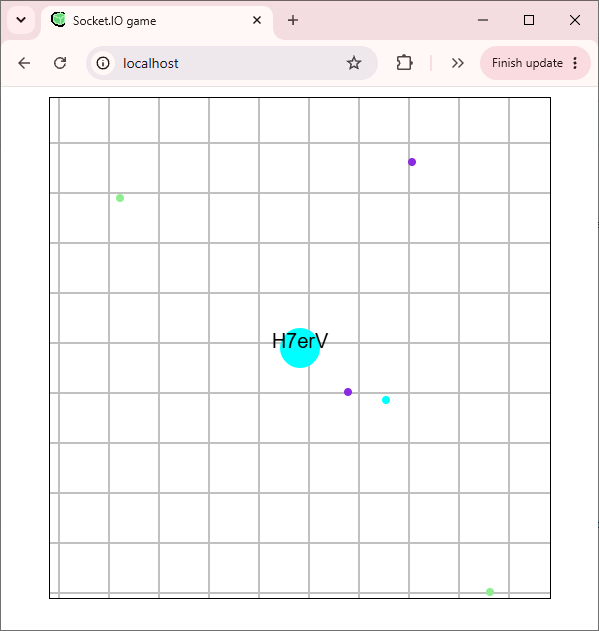

# Dot-Game

A JavaScript game project exploring real-time communication with web sockets between a client and server using Node.js and Socket.IO.

## Overview

Dot-Game is a personal software development project focused on learning and implementing real-time, event-driven communication in a browser-based game.

The project seperates the client and server into their own directories to keep the frontend and backend code organized.



## Technologies

- JavaScript - Application logic
- Node.js - Server-side runtime
- Socket.IO - Real-time, event-based communication
- HTML/CSS - Browser interface

## Getting Started

### Prerequisites

- Node.js
- npm (included with Node.js)

### Installation

1. Clone the repo:

`git clone https://github.com/Artemsuprun/Dot-Game.git`

2. Navigate into the project

`cd Dot-Game`

3. Install the dependencies using the package.json files provided by the project.

```
npm install
```

### Running the Program

Start the server:

`node server`

Then open the client interface by typing this into the web browser:

`localhost`

When finished with testing (or playing) the program, you can close the web tab and hit ctrl + c to stop the server process. 

## Future Improvements

- Improve project structure.
- Add documentation for communication events and work flow.
- Add automated tests.
- Improve error handling and connection management.

## License

This project is licensed under the **MIT** license. 
